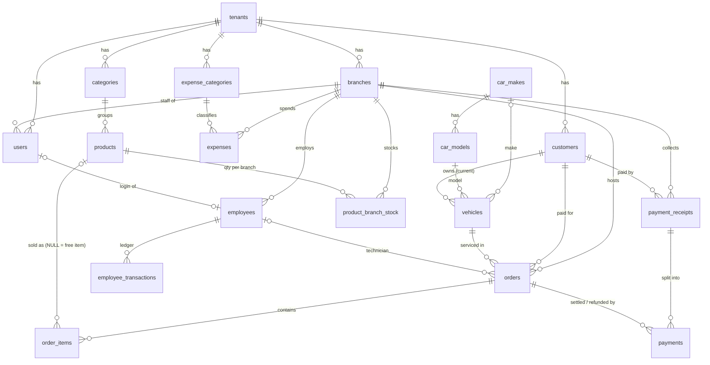
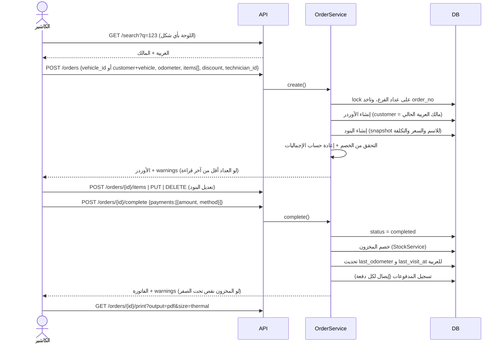

# Dawar Backend — شرح المشروع كامل

> الملف ده بيشرح اللي اتعمل في المشروع لحد دلوقتي: إحنا وصلنا لفين، وهيكلية الكود، والجداول وعلاقاتها، والـ flows الأساسية خطوة بخطوة، والقرارات اللي اتاخدت، والحاجات اللي محتاجة مراجعة منك.
>
> المراجع الأصلية: `brief.md` (المطلوب من النظام) و `shortdoc.md` (تصميم الداتابيز، وفي أوله قسم "تعديلات معتمدة").

---

## 1. إحنا فين دلوقتي؟

**الـ MVP كله اتبنى (كل المراحل من 0 لـ 9) ومتختبر.** المشروع API بس (مفيش واجهة)، ومعمول بـ Laravel 13 و PHP 8.4 و MySQL 8.

| المرحلة | المحتوى | الحالة |
|---|---|---|
| 0 | الأساس: الـ packages، شكل الـ response، الأخطاء، اللغة، الفلوس، الـ tests | ✅ |
| 1 | المراكز (Tenants)، الفروع، الدخول، الـ Super Admin، المستخدمين، الصلاحيات، العزل | ✅ |
| 2 | العملاء، العربيات، الماركات والموديلات، البحث السريع | ✅ |
| 3 | الكتالوج (تصنيفات ومنتجات وخدمات)، المخزون لكل فرع | ✅ |
| 4 | الأوردرات / الفواتير (الـ POS) | ✅ |
| 5 | المدفوعات، الإيصالات، المديونية، الأرصدة الافتتاحية | ✅ |
| 6 | الطباعة (JSON + PDF عربي A4 وحراري 80mm) | ✅ |
| 7 | الموظفين، المرتبات والسلف، المصروفات | ✅ |
| 8 | التقارير والـ Dashboard + تصدير Excel | ✅ |
| 9 | بيانات ديمو، CI/Deploy، Postman collection | ✅ |
| بعد الـ MVP | دور "فني وكاشير"، حساب الدخول من صفحة الموظف، شاشة الفاتورة في call واحد (عميل وعربية inline + قفل + تحصيل)، الباركود، إجمالي المنتجات والصيانة، رقم الفاتورة المتوقع (شوف القسم 13) | ✅ |

**بالأرقام:**
- 109 endpoint.
- 140 test (685 assertion)، كلهم ناجحين.
- commits محلية على `main`. **مفيش push** لسه.

```
3b4b88c  milestone 9: demo data, CI/deploy, Postman
d95b6ee  milestones 2-8: العملاء ... التقارير
8086367  milestone 1: tenancy, auth, admin, users
1066470  milestone 0: الأساس
```

---

## 2. القرارات الأساسية (واختلافها عن `shortdoc.md`)

القرارات دي اتاخدت بعد الأسئلة في أول المحادثة، ومتسجلة في أول `shortdoc.md`:

| الموضوع | الـ shortdoc كان بيقول | اللي اتنفذ |
|---|---|---|
| الداتابيز | PostgreSQL + RLS | **MySQL 8**. ومفيش RLS لأنه مش موجود في MySQL |
| الـ IDs | uuid | **bigint** auto-increment |
| العزل | RLS + Composite FKs | **Global Scope** في Laravel + **Composite FKs** في الداتابيز + **tests** |
| الفروع | مرحلة تانية | **موجودة من الأول**: جدول `branches` و `branch_id` على البيانات اللي بتخص الفرع |
| ترقيم الفواتير | لكل مركز | **لكل فرع** |
| الماركة والموديل | نص حر | جداول عامة `car_makes` / `car_models` (الأدمن بس هو اللي يضيف فيها) |
| المخزون | `products.stock_qty` | جدول `product_branch_stock` (رصيد لكل منتج في كل فرع) |
| التحصيل | `payments` بس | `payment_receipts` (الإيصال) + `payments` (توزيع الإيصال على الأوردرات) |
| التصحيح | غير محدد | **Void بسبب**. مفيش تعديل ولا حذف لأي حركة مالية |
| الإلغاء بعد الدفع | غير محدد | **Refund**: بيتسجل كفلوس خارجة من الخزنة |
| تسجيل مركز جديد | — | **الأدمن بس**. مفيش self-signup |

---

## 3. هيكلية الكود

المعمارية نفس معمارية fitZone: **Controller → FormRequest → Service → Model → Resource**.

```
app/
├── Enums/                    القيم الثابتة: الأدوار، حالات الأوردر، طرق الدفع، ...
│                             (كل enum فيه LABELS عربي/إنجليزي، و ->response() بترجع {label, value})
├── Exceptions/
│   ├── BusinessRuleException       أي خطأ بيزنس: رسالة للمستخدم + HTTP code
│   └── MissingTenantContextException  حماية: query على داتا مركز من غير ما يكون المركز متحدد
├── Exports/ArrayExport.php   تصدير Excel عام (RTL)
├── Http/
│   ├── Controllers/Controller.php    الأساس: response() و paginate() و failed() و excel()
│   ├── Controllers/V1/Admin/*        APIs الـ Super Admin
│   ├── Controllers/V1/Center/*       APIs المركز
│   ├── Middleware/                   العزل، الصلاحيات، الاشتراك، اللغة
│   ├── Requests/                     الـ validation (AbstractFormRequest و IndexRequest)
│   ├── Resources/V1/...              شكل الـ JSON الراجع
│   └── Helpers/helpers.php           دوال عامة: actor(), tenantContext(), money(), tenantExists() ...
├── Models/
│   └── Concerns/                     BelongsToTenant, BelongsToBranch, Voidable
├── Services/V1/                      ★ كل الـ business logic هنا
│   └── Admin/                        خدمات الأدمن (إنشاء مركز، الفروع، ...)
├── Support/
│   ├── Money.php                     حسابات الفلوس بدقة (brick/math) من غير float
│   ├── Period.php                    تحويل "من يوم لـ يوم" بتوقيت القاهرة لحدود UTC
│   ├── PlateNormalizer.php           توحيد شكل اللوحة
│   ├── PhoneNormalizer.php           توحيد شكل التليفون
│   ├── Tenancy/TenantContext.php     "المركز الحالي"
│   └── Tenancy/BranchContext.php     "الفرع الحالي"
│   └── Traits/ResponseTrait, EnumTrait
config/rbac.php                       ★ الصلاحيات لكل دور
config/dawar.php                      بيانات الأدمن الأولاني
routes/api.php                        بيحمّل routes/api/v1/{admin,center}/*.php
resources/views/pdf/                  قوالب الفاتورة والإيصال
database/migrations, seeders
tests/                                CenterHttpTestCase (أساس الـ tests) + Feature + Unit
postman/                              Collection + Environment
```

### رحلة أي request جوه النظام

```mermaid
flowchart LR
    A[Request] --> B[ResetTenancyContext<br/>تصفير المركز والفرع]
    B --> C[SetLang<br/>header lang]
    C --> D[auth:sanctum<br/>مين صاحب التوكن]
    D --> E[tenant<br/>تحديد المركز من التوكن]
    E --> F[branch<br/>تحديد الفرع]
    F --> G[subscription<br/>الاشتراك منتهي؟ يبقى قراءة بس]
    G --> H[permission:x<br/>صلاحية الدور]
    H --> I[FormRequest<br/>validation]
    I --> J[Controller]
    J --> K[Service<br/>البيزنس + DB transaction]
    K --> L[Resource<br/>شكل JSON]
    L --> M["{status, msg, data, pagination}"]
```



### شكل الـ Response

```json
{ "status": true, "msg": "تمت الإضافة بنجاح", "data": { ... }, "pagination": { ... } }
```

- **الأخطاء:** `{status:false, msg, code?, data}`. الـ `code` بيظهر في أخطاء معينة، زي `branch_required` و `subscription_expired` و `account_inactive`.
- **أخطاء الـ validation:** شكلها زي fitZone بالظبط: `{status:0, code:422, message, data:null}`، وبترجع **أول خطأ بس**.
- **اللغة:** header اسمه `lang`، والـ default `ar`.
- **التواريخ:** unix timestamp. **الفلوس:** رقم بخانتين عشريتين.

---

## 4. العزل بين المراكز والفروع (أهم جزء أمنياً)

### المركز (Tenant)
1. أي user مربوط بمركز (`users.tenant_id`). أول ما الـ request يعدّي من الـ auth، الـ middleware `tenant` بياخد المركز **من صاحب التوكن**. **عمر ما المركز بييجي من الـ body ولا من header.**
2. أي model بتاع مركز عليه `BelongsToTenant`، وده بيعمل 3 حاجات:
   - بيضيف `where tenant_id = المركز الحالي` تلقائي على **كل** query.
   - بيحط `tenant_id` تلقائي عند الإنشاء (ومش موجود في `fillable` أصلاً).
   - لو حصل query من غير ما يكون فيه مركز متحدد، بيرمي exception بدل ما يرجع داتا كل المراكز (fail-closed).
3. **في الداتابيز نفسها:** كل جدول عليه `UNIQUE(tenant_id, id)`، وكل علاقة FK مركبة `(tenant_id, x_id)`. يعني مستحيل أوردر في مركز A يشاور على عميل في مركز B حتى لو الكود غلط.
4. لو حد بعت ID من مركز تاني، النتيجة **404**.

### الفرع (Branch)
- **الكاشير والفني** مربوطين بفرع واحد (`users.branch_id`). لو بعتوا `X-Branch-Id` لفرع تاني بياخدوا 403.
- **الـ Owner** (`branch_id = null`) بيشوف كل الفروع. يقدر يحدد فرع بالـ header `X-Branch-Id`:
  - من غير header: القراءة بترجع **كل الفروع**.
  - الكتابة (أوردر، مصروف، ...): لو المركز فيه فرع واحد بيتحدد تلقائي. لو أكتر بياخد 422 بـ `branch_required`.
- الـ models اللي بتخص الفرع عليها `BelongsToBranch`: الأوردرات، المدفوعات، الإيصالات، المصروفات، الموظفين وحركاتهم، المخزون.
- العملاء والعربيات والكتالوج وتصنيفات المصروفات **على مستوى المركز** وبيتشاركوا بين كل الفروع.

### ثغرتين اتصلحوا أثناء الشغل (والـ tests بتغطيهم دلوقتي)
1. كان الكاشير يقدر يفتح أوردر من فرع تاني لو عرف الـ ID، لأن فلتر الفرع كان بيشتغل بعد ما Laravel يجيب الـ model. اتصلحت بإن الـ middleware بتاع المركز والفرع بقى يشتغل **قبل** route model binding.
2. المركز اللي اتحدد في request كان ممكن يفضل موجود في الـ request اللي بعده. اتعمل middleware بيصفّر المركز والفرع في أول كل request.

---

## 5. الأدوار والصلاحيات

المكان الوحيد اللي بيتعرف فيه مين يعمل إيه هو `config/rbac.php`. الـ Owner عنده كل حاجة (`*`).

**"فني وكاشير"** (`technician_cashier`) للورش المتوسطة، اللي فيها نفس الصنايعي بيشتغل ويبيع ويحاسب. صلاحياته **نفس الكاشير بالظبط**، والفرق إنه مربوط بسجل موظف، فأي أوردر بيفتحه بيتحط هو الفني بتاعه تلقائي.

| الصلاحية | Owner | Cashier | فني وكاشير | Technician |
|---|:-:|:-:|:-:|:-:|
| عرض العملاء والعربيات | ✅ | ✅ | ✅ | ✅ |
| إضافة / تعديل عملاء وعربيات | ✅ | ✅ | ✅ | ❌ |
| عرض الكتالوج | ✅ | ✅ | ✅ | ✅ |
| تعديل الكتالوج والأسعار وتعديل المخزون يدوي | ✅ | ❌ | ❌ | ❌ |
| رؤية سعر التكلفة | ✅ | ❌ | ❌ | ❌ |
| فتح أوردر وإضافة بنود | ✅ | ✅ | ✅ | ✅ |
| تغيير سعر بند من الكتالوج | ✅ | ✅ | ✅ | ❌ (يقدر يضيف صنف حر بسعره) |
| خصم | ✅ بلا حد | ✅ لحد `cashier_max_discount` | ✅ لحد `cashier_max_discount` | ❌ |
| رؤية الأوردرات المقفولة | ✅ | ✅ | ✅ | ❌ (المفتوح بس) |
| قفل الأوردر والتحصيل | ✅ | ✅ | ✅ | ❌ |
| تعديل أو إلغاء فاتورة مقفولة | ✅ | ❌ | ❌ | ❌ |
| إبطال إيصال | ✅ | ❌ | ❌ | ❌ |
| رصيد افتتاحي | ✅ | ❌ | ❌ | ❌ |
| المصروفات (تسجيل وعرض) | ✅ | ✅ | ✅ | ❌ |
| إبطال مصروف | ✅ | ❌ | ❌ | ❌ |
| الموظفين والمرتبات | ✅ | ❌ | ❌ | ❌ |
| التقارير | ✅ | ❌ | ❌ | ❌ |
| المستخدمين والإعدادات وسجل التعديلات | ✅ | ❌ | ❌ | ❌ |

**الـ Super Admin** حساب منفصل تماماً (جدول `admins`). توكنه مايشتغلش على APIs المركز، وتوكن المركز مايشتغلش على APIs الأدمن.

**الاشتراك:** لو `subscription_ends_at` عدّى، المركز بيتحول **قراءة بس**: أي GET شغال، وأي كتابة بترجع **402** بـ `subscription_expired`. الـ logout وتغيير كلمة السر شغالين عادي.

---

## 6. قاعدة البيانات والعلاقات

### الرسم الكامل



### الجداول واحد واحد

**المنصة (عامة، مش تبع مركز):**

| الجدول | الغرض |
|---|---|
| `admins` | حسابات الـ Super Admin |
| `tenants` | المراكز. فيها الاسم، اللوجو، الـ plan، `subscription_ends_at`، `cashier_max_discount`، `timezone` (default `Africa/Cairo`)، `is_active` |
| `car_makes` / `car_models` | ماركات وموديلات العربيات. فيها seed بـ 30 ماركة منتشرة في مصر، والأدمن بس هو اللي يضيف |
| `personal_access_tokens` | توكنات Sanctum (للأدمن والـ users) |

**المركز والفرع:**

| الجدول | الغرض | ملاحظات |
|---|---|---|
| `branches` | فروع المركز | فيه `next_order_no` و `next_receipt_no`، العدادين اللي بيدّوا أرقام الفواتير والإيصالات. وأول فرع `is_default` ومايتوقفش |
| `users` | حسابات الدخول: owner، كاشير، فني، فني وكاشير | الإيميل unique على المنصة كلها. و `branch_id = null` يعني owner |
| `audit_logs` | سجل التعديلات الحساسة | مين، عمل إيه، القيم قبل وبعد، السبب، الـ IP |

**العملاء والعربيات:**

| الجدول | الغرض | ملاحظات |
|---|---|---|
| `customers` | العملاء | التليفون **unique جوه المركز** وبيتخزن أرقام بس. soft delete، والعميل المحذوف بيحرر رقمه |
| `vehicles` | العربيات | `customer_id` = **المالك الحالي**. `plate_number` زي ما اتكتبت، و `plate_normalized` للبحث والـ unique. `last_odometer` و `last_visit_at` **cache** بيتحدث من الأوردرات |

> **حيلة الـ unique مع الحذف:** MySQL مفيهوش "unique بشرط". فاتعمل عمود محسوب، زي `phone_active = IF(deleted_at IS NULL, phone, NULL)`، وعليه unique. يعني التكرار ممنوع بين الصفوف الحية بس.

**الكتالوج:**

| الجدول | الغرض | ملاحظات |
|---|---|---|
| `categories` | تصنيفات الـ POS | بيتعمل seed بـ: زيوت، فلاتر، كاوتش، بطاريات، عمالة / مصنعية |
| `products` | المنتجات والخدمات | `kind` = part أو service. الخدمة عمرها ما بتتبع مخزون. `cost_price` اختياري ومخفي عن غير الـ owner. `barcode` اختياري و unique جوه المركز |
| `product_branch_stock` | الرصيد في كل فرع | مفيش غير `StockService` اللي بيكتب فيه |

**الأوردرات والفلوس:**

| الجدول | الغرض | ملاحظات |
|---|---|---|
| `orders` | **الأوردر هو الفاتورة** | `status`: open أو completed أو cancelled. `order_no` متسلسل لكل فرع. `subtotal` و `discount` و `total` و `paid` **بيتحسبوا من الجداول التانية** ومش بيتكتبوا يدوي. وعليه CHECK في الداتابيز: `0 ≤ discount ≤ subtotal` و `0 ≤ paid ≤ total` |
| `order_items` | البنود | **Snapshot**: الاسم والسعر والتكلفة بيتنسخوا وقت البيع. `product_id = NULL` يعني صنف حر. `line_total` عمود محسوب في الداتابيز |
| `payment_receipts` | إيصال التحصيل | عملية تحصيل واحدة = إيصال واحد برقم متسلسل للفرع. والإبطال بيتعمل على الإيصال كله |
| `payments` | توزيع الفلوس على الأوردرات | `type`: payment (داخل) أو refund (مرتجع). `branch_id` هو الفرع اللي الفلوس دخلت درجه، ومش لازم يكون فرع الأوردر |

**الموظفين والمصروفات:**

| الجدول | الغرض | ملاحظات |
|---|---|---|
| `employees` | الموظفين | تبع فرع. حساب الدخول (user) بيتعمل من صفحة الموظف نفسها (`account`) ويتربط بـ `user_id` |
| `employee_transactions` | **دفتر حساب الموظف** | salary و bonus بيزودوا اللي ليه. deduction و advance و payment بينقصوه. ومرتب واحد بس لكل موظف في الشهر (unique على عمود محسوب) |
| `expense_categories` | تصنيفات المصروفات | بيتعمل seed بـ: إيجار، كهرباء، مياه، مرافق، نثريات |
| `expenses` | المصروفات | `spent_at` تاريخ، و `method` طريقة الدفع |

**الـ Views (حسابات جاهزة في الداتابيز):**

| الـ View | بيحسب إيه |
|---|---|
| `vehicle_balances` | مديونية كل (عميل، عربية) = `SUM(total − paid)` للأوردرات `completed` بس |
| `employee_balances` | رصيد كل موظف = (مرتب + حوافز) − (خصومات + سلف + قبض)، من غير الحركات الملغية |

> **المديونية عمرها ما بتتخزن** في عمود على العميل. بتتحسب دايماً من الأوردرات، وفيه test بيتأكد إن مفيش عمود اسمه `debt` أو `balance`.

---

## 7. الـ Flows خطوة بخطوة

### 7.1 إنشاء مركز جديد (الأدمن)
`POST /api/v1/admin/tenants`. الـ `TenantProvisioningService` بيعمل كله في **transaction واحدة**:
1. ينشئ المركز.
2. ينشئ "الفرع الرئيسي" (`is_default`).
3. ينشئ حساب الـ Owner.
4. يعمل seed لتصنيفات المنتجات والمصروفات الافتراضية.

بعدها الـ owner يقدر يعمل login على طول. الفروع الإضافية برضه الأدمن بس اللي يعملها.

### 7.2 الدخول
`POST /center/auth/login` (محدود بـ 5 محاولات في الدقيقة).
- بيرفض لو الـ user أو المركز موقوف.
- بيرجع: `token`، وبيانات الـ user، وبيانات المركز، والفروع المتاحة، وقائمة صلاحياته (عشان الفرونت يخفي الأزرار).
- إيقاف user أو مركز بيمسح توكناته فوراً.

### 7.3 فتح أوردر وقفله (قلب النظام)



**أو في call واحد (زرار "حفظ الفاتورة"):** نفس `POST /orders` ومعاه `complete: true` و `payments[]`. الأوردر بيتعمل ويتقفل ويتحصّل **في transaction واحدة**، ولو أي جزء فشل (مثلاً المدفوع أكبر من الإجمالي) مفيش حاجة بتتسجل خالص، لا عميل ولا أوردر ولا رقم فاتورة.

**عميل أو عربية جديدة من شاشة الفاتورة:** بدل `vehicle_id` بيتبعت `customer {name, phone}` (أو `customer {id}`) و `vehicle {plate_number, vin, car_make_id, ...}`:
- **العميل:** لو التليفون متسجل بيتستخدم العميل الموجود (والاسم مابيتغيرش)، ولو مش متسجل بيتعمل جديد.
- **العربية:** لو اللوحة متسجلة لنفس العميل بتتستخدم. لو متسجلة **لعميل تاني** بيرجع 422 (دي نقل ملكية، مش زيارة جديدة). ولو مش متسجلة بتتعمل جديدة.
- إضافة عميل أو عربية محتاجة `customers.manage`، فالفني العادي لازم يختار عربية متسجلة.

**الرد** فيه `parts_total` (إجمالي المنتجات) و `services_total` (إجمالي الصيانة) قبل الخصم، زي خانات الشاشة. والطباعة فيها نفس الحقلين.

**القواعد:**
- **العميل** بيتحدد تلقائي = مالك العربية **وقت الأوردر**.
- **العداد:** لو القراءة أقل من آخر قراءة بيطلع **تحذير** في `warnings` من غير ما يمنع.
- **الخصم:** على إجمالي الفاتورة (مبلغ)، والكاشير ليه حد أقصى بالجنيه.
- **الإجماليات:** بعد أي تغيير، `OrderTotalsService` بيعيد الحساب **من الصفر**: subtotal من البنود، و paid = مدفوعات − مرتجعات (من غير الملغي)، و total = subtotal − discount.
- **قفل أوردر فاضي** ممنوع.
- **المخزون:** مابيتخصمش وهو open. بيتخصم عند القفل. لو الرصيد مش كفاية **البيع مابيتمنعش**، بيطلع تحذير بس.
- **الفني** يقدر يتختار لو موظف نشط في نفس الفرع. ولو اللي فاتح الأوردر "فني" أو "فني وكاشير" ومربوط بموظف، ومابعتش `technician_id`، بيتحط هو الفني تلقائي.

### 7.4 تعديل فاتورة مقفولة (الـ Owner بس)
- الـ owner يعدل البنود أو الخصم مباشرة والفاتورة `completed` (من غير ما يرجعها open).
- فرق الكمية بيطلع أو يرجع من المخزون **فوراً**.
- كل تعديل بيتسجل في `audit_logs` بالقيمة قبل وبعد.
- **ممنوع** الإجمالي يقل عن المدفوع. لازم الدفعة تتعمل void الأول.
- الكاشير بياخد 403.

### 7.5 إلغاء أوردر
- **أوردر open:** أي حد يقدر يفتح أوردرات يقدر يلغيه.
- **فاتورة completed:** الـ owner بس، و**بسبب إلزامي**. وساعتها:
  1. لو عليها فلوس بيتعمل **refund**: صف `refund` لكل طريقة دفع بصافي المدفوع (مثلاً 300 كاش و100 InstaPay)، بتاريخ النهارده. فبيظهر في الخزنة كفلوس خارجة النهارده.
  2. المخزون بيرجع.
  3. آخر زيارة للعربية بتتحسب تاني.
  4. بيتسجل في الـ audit.
- الأوردر الملغي مابيتعدلش تاني.

### 7.6 التحصيل والمديونية

**المبدأ:** الفلوس دايماً مربوطة **بأوردر**، والأوردر مربوط بعربية. عشان كده نقدر نعرف الدين على كل عربية لوحدها.

**3 طرق للتحصيل:**

| الطريقة | Endpoint | بيعمل إيه |
|---|---|---|
| على أوردر معين | `POST /orders/{id}/payments` | دفعة على الأوردر ده. **مسموح على أوردر open (عربون)**، ومايزيدش عن المتبقي |
| من صفحة العميل | `POST /customers/{id}/payments` (+ `vehicle_id` اختياري) | **دفعة مجمّعة** بتتوزع على فواتيره المقفولة **من الأقدم للأحدث** |
| من صفحة العربية | `POST /vehicles/{id}/payments` | نفس اللي قبلها، بس على فواتير العربية دي اللي على **مالكها الحالي** |

**مثال الـ brief (فيه test):** عميل عليه 300 على عربية 1 (الأقدم) و400 على عربية 2، ودفع 500:

```
إيصال رقم N = 500
  ├── payment 300 → فاتورة عربية 1 → المتبقي 0
  └── payment 200 → فاتورة عربية 2 → المتبقي 200
```

- لو المبلغ أكبر من إجمالي الدين: 422.
- لو مفيش دين أصلاً: 422.
- **رقم الإيصال** متسلسل لكل فرع. والإيصال بيتسجل على الفرع اللي الفلوس دخلت درجه.
- **إبطال إيصال** (`PATCH /receipts/{id}/void` بسبب، للـ owner بس): الإيصال وكل الـ payments اللي تحته بتتلغي، والدين بيرجع. ومش مسموح لو الإيصال بيغطي أوردر اتلغى، لأن الفلوس اترجعت خلاص.

**عرض المديونية:**
- `GET /customers/{id}` فيها `debts`: الإجمالي + تفصيل لكل عربية.
- `GET /vehicles/{id}` فيها `balance`: دين المالك الحالي على العربية.

### 7.7 نقل ملكية عربية
`PATCH /vehicles/{id}/transfer-owner`: بيتغير `vehicles.customer_id` بس. **الفواتير القديمة وديونها بتفضل على المالك القديم**، وبتظهر في صفحته تحت العربية دي. والعملية بتتسجل في الـ audit.

### 7.8 الرصيد الافتتاحي (ديون الدفتر الورق)
`POST /vehicles/{id}/opening-balance {amount}` (للـ owner بس). بيعمل أوردر `completed` و `is_opening_balance = true` ومعاه بند واحد "رصيد افتتاحي". النتيجة:
- **بيتحسب دين** ويتحصّل زي أي فاتورة.
- **مابيدخلش** في تقارير المبيعات ولا الأرباح، ومابيظهرش في ليستة الأوردرات العادية.
- مابيأثرش على العداد ولا آخر زيارة.

### 7.9 المخزون
- **التعديل اليدوي:** `PATCH /products/{id}/stock {qty, reason}` (للـ owner، على الفرع المختار). بيتسجل في الـ audit.
- **البيع:** عند القفل بيتخصم، وعند الإلغاء بيرجع، وعند تعديل فاتورة مقفولة بيتظبط بالفرق.
- بيتأثر بس المنتجات اللي `track_stock = true`.
- الـ rows بتتقفل مترتبة بالـ product_id عشان مايحصلش deadlock.

### 7.10 الموظفين والمرتبات
- **حساب الدخول من صفحة الموظف (زي fitZone):** `POST /employees` أو `PUT /employees/{id}` ومعاه `account {email, password, role}`. الدور واحد من cashier أو technician أو technician_cashier (**owner ممنوع**). الحساب بيتعمل في نفس فرع الموظف وبنفس اسمه.
  - تعديل اسم الموظف بيعدّل اسم الحساب.
  - **إيقاف الموظف** بيوقف حسابه ويطلّعه من النظام فوراً.
- كل حاجة تخص الموظف **صف في دفتر حسابه** (`employee_transactions`).

  | الحركة | التأثير على رصيد الموظف |
  |---|---|
  | `salary` (مرتب) | + |
  | `bonus` (حافز) | + |
  | `deduction` (خصم / جزاء) | − |
  | `advance` (سلفة) | − |
  | `payment` (قبض فعلي) | − |

- **رصيد موجب** يعني المركز عليه فلوس للموظف. **سالب** يعني الموظف عليه سلف.
- **مثال (فيه test):** مرتب 5000 وسلفة 1000، يبقى رصيده 4000. السلفة بتتخصم أوتوماتيك من غير أي logic زيادة.
- **إصدار مرتبات الشهر:**
  - `GET /payroll/preview?period=2026-10` بيعرض الموظفين ومين اتصرفله قبل كده.
  - `POST /payroll/issue` بيعمل `salary` لكل موظف نشط في الفرع بمرتبه الأساسي، مع إمكانية تعديل المبلغ لموظف معين.
- **مرتب واحد بس لكل موظف في الشهر.** لو اتعمل void للأول، مسموح بواحد جديد.
- كشف الحساب: `GET /employees/{id}/statement`.
- **كل حركات الموظف كاش** (ده كان اختيارك)، فالسلف والقبض بيطلعوا من الخزنة.

### 7.11 المصروفات
- تسجيل: `POST /expenses {category_id, amount, method, spent_at}` (الكاشير والـ owner).
- ليستة بفلتر بالتاريخ والتصنيف وطريقة الدفع. وملخص بيقسم حسب التصنيف وطريقة الدفع (`/expenses/summary`).
- الغلط بيتصحح بـ **void** (owner)، مش تعديل ولا حذف.

### 7.12 التقارير (للـ Owner)
كل الفترات بتتحسب **بأيام القاهرة**، يعني عملية الساعة 11:30 بالليل بتتحسب في نفس اليوم (فيه test). والتقرير بيتبع الفرع المختار، ولو مفيش فرع متحدد بيجيب كل الفروع.

| التقرير | Endpoint | المعادلة |
|---|---|---|
| Dashboard اليوم | `/reports/today` | عدد الأوردرات، المبيعات، المحصّل، الديون الجديدة، المصروفات، الأوردرات المفتوحة، إجمالي الديون |
| المبيعات | `/reports/sales` | الفواتير المقفولة في الفترة (من غير الملغي والرصيد الافتتاحي) + توزيع على الأيام + التحصيل حسب طريقة الدفع |
| الديون | `/reports/debts?sort=amount\|oldest` | العملاء المدينين، ولكل عميل تفصيل على عربياته |
| الأرباح | `/reports/profit` | المبيعات − تكلفة البضاعة (من التكلفة اللي اتنسخت في البنود) − المصروفات − المرتبات (مرتب + حوافز − خصومات) |
| حركة الخزنة | `/reports/cash-flow` | الداخل: تحصيل كاش. الخارج: مرتجعات كاش + مصروفات كاش + سلف + قبض |
| عربيات مستحقة صيانة | `/reports/service-due?days=7` | العربيات اللي تاريخ صيانتها الجاية (من آخر فاتورة ليها) قرّب أو عدّى |

- كلها بتدعم `?format=excel`.
- تقرير الأرباح بيرجع `items_without_cost`: عدد البنود اللي ملهاش تكلفة متسجلة، عشان تعرف الربح محسوب على أد إيه.
- **ملحوظة:** السلفة **مش مصروف** في الأرباح، لأنها بتتخصم من المرتب. لكنها **فلوس خارجة** في حركة الخزنة.

### 7.13 الطباعة
- `GET /orders/{id}/print` بيرجع JSON فيه كل بيانات الفاتورة، والفرونت يرسمها ويطبعها.
- `?output=pdf&size=a4` أو `size=thermal` بيرجع **PDF عربي RTL** (اتجرب واتفتح وطالع سليم)، وفيه اسم ولوجو المركز.
- نفس الكلام لإيصال التحصيل: `GET /receipts/{id}/print`.

---

## 8. خريطة الـ APIs

**الأدمن** (`/api/v1/admin`):

| المجموعة | Endpoints |
|---|---|
| الدخول | `auth/login`، `auth/logout`، `auth/me` |
| المراكز | `tenants` (index, store, show, update)، `tenants/toggle/{id}`، `tenants/{id}/subscription` |
| الفروع | `tenants/{id}/branches` (index, store, update, toggle) |
| الماركات والموديلات | `car-makes` (index, store, update, toggle)، `car-makes/{id}/models`، `car-models/{id}`، `car-models/toggle/{id}` |

**المركز** (`/api/v1/center`):

| المجموعة | Endpoints |
|---|---|
| الدخول | `auth/login`، `auth/logout`، `auth/me`، `auth/password` |
| الإعدادات | `settings` (GET, PUT)، `settings/logo` |
| المستخدمين | `users` (CRUD من غير delete) + `users/toggle/{id}` |
| السجل | `audit-logs` |
| مساعدات | `search?q=`، `car-makes`، `options` (القوائم الثابتة للفرونت) |
| العملاء | `customers` (CRUD)، `customers/{id}/balance`، `customers/{id}/payments` |
| العربيات | `vehicles` (CRUD)، `vehicles/{id}/transfer-owner`، `vehicles/{id}/history`، `vehicles/{id}/payments`، `vehicles/{id}/opening-balance` |
| الكتالوج | `pos/catalog?q=` (باركود أو اسم، ومعاه `next_order_no`)، `categories` (CRUD + toggle)، `products` (CRUD + toggle)، `products/{id}/image`، `products/{id}/stock` |
| الأوردرات | `orders` (index, store, show, update)، `orders/{id}/items` و `items/{item}`، `orders/{id}/complete`، `orders/{id}/cancel`، `orders/{id}/payments`، `orders/{id}/print` |
| الإيصالات | `receipts`، `receipts/{id}`، `receipts/{id}/void`، `receipts/{id}/print` |
| الموظفين | `employees` (CRUD + toggle، ومعاه حساب الدخول `account`)، `employees/technicians`، `employees/{id}/statement`، `employees/{id}/transactions`، `employee-transactions/{id}/void`، `payroll/preview`، `payroll/issue` |
| المصروفات | `expense-categories` (CRUD + toggle)، `expenses` (index, store, show)، `expenses/summary`، `expenses/{id}/void` |
| التقارير | `reports/today`، `sales`، `debts`، `profit`، `cash-flow`، `service-due` |

التفاصيل الكاملة وأمثلة الـ bodies في **`postman/Dawar.postman_collection.json`**.

---

## 9. الـ Tests

- **المكان:** `tests/Feature/{Admin,Center}` و `tests/Unit`. والـ base class اسمه `tests/CenterHttpTestCase.php`، وفيه helpers بتنشئ مركز وفرع وموظفين وعملاء وأوردرات.
- **الداتابيز:** بيشتغلوا على MySQL **`dawar_test`** بس. والـ TestCase **بيرفض يشتغل** على أي داتابيز اسمها مش منتهي بـ `_test`، عشان مايمسحش داتا حقيقية.
- **التشغيل:** `php artisan test --compact`.

**اللي متغطي:**

| الملف | بيختبر |
|---|---|
| `TenancyIsolationTest` | IDs من مركز تاني بترجع 404، و `tenant_id` في الـ body بيتجاهل، والفروع متقفلة على أصحابها |
| `AccessControlTest`، `AuthTest` | الصلاحيات، والاشتراك المنتهي، والدخول، والـ throttle |
| `CustomerVehicleTest` | التليفون واللوحة (بأي شكل كتابة)، والبحث، ونقل الملكية، والحذف مع الدين |
| `CatalogTest` | الكتالوج، وإخفاء التكلفة، والمخزون لكل فرع |
| `OrderTest` | الإجماليات، والـ snapshot، وحدود الخصم، وتغيير السعر، والعداد، والترقيم لكل فرع، والمخزون، وتعديل وإلغاء الفاتورة المقفولة، ورؤية الفني |
| `PaymentTest` | العربون، والتوزيع من الأقدم، و 300+400+0 = 700، والـ void، والـ refund، والرصيد الافتتاحي، وترقيم الإيصالات |
| `EmployeePayrollTest` | 5000 − 1000 = 4000، ومرتب مرة واحدة في الشهر، وإصدار المرتبات |
| `ExpenseTest`، `ReportTest` | المصروفات، وكل التقارير، وحدود اليوم بتوقيت القاهرة، والـ Excel |
| `PrintTest` | JSON، و PDF بالمقاسين، ومنع طباعة فاتورة مركز تاني |
| `TechnicianCashierTest` | الحساب من صفحة الموظف، ومنع دور owner، والإيقاف بيطلّعه، وصلاحياته = الكاشير، والفني الافتراضي |
| `InvoiceScreenTest` | العميل والعربية inline، وإعادة استخدام التليفون واللوحة، ولوحة عميل تاني، والحفظ في call واحد، والـ rollback، والباركود، ورقم الفاتورة المتوقع |

---

## 10. إزاي تشغل المشروع

```bash
composer install
php artisan migrate --force
php artisan db:seed --class=DemoSeeder   # بيانات تجريبية جاهزة
php artisan storage:link
php artisan serve
```

> ⚠️ **الداتابيز المحلية `dawar` اتمسحت واتعملت من الأول** (`migrate:fresh`) وفيها دلوقتي بيانات الديمو.

**حسابات الديمو** (كلمة السر لكلهم `password`):

| الحساب | الدور |
|---|---|
| `owner@dawar.test` | صاحب المركز |
| `cashier@dawar.test` | كاشير (الفرع الرئيسي) |
| `tech@dawar.test` | فني |
| `worker@dawar.test` | فني وكاشير (اتعمل من صفحة الموظف) |
| `admin@dawar.test` | Super Admin |

بيانات الديمو فيها:
- مركز بفرعين.
- 8 عملاء بعربياتهم.
- 9 منتجات وخدمات بمخزون.
- 6 فواتير بدفع كامل وجزئي وآجل.
- أوردر مفتوح، ورصيد افتتاحي، ومصروفات.

**Postman:** استورد الملفين اللي في `postman/`، وشغّل `center.auth.login`. التوكن ورقم الفرع بيتحفظوا لوحدهم.

**CI/Deploy:**
- `.github/workflows/ci.yml` بيشغل Pint والـ tests على كل push و PR.
- `deploy.yml` بيعمل deploy بـ SSH بعد ما الـ CI ينجح، وده **محتاج** secrets: `SERVER_HOST` و `SERVER_USER` و `SERVER_SSH_KEY`، ومسار المشروع على السيرفر.
- `deploy/dawar-api-worker.conf` إعداد الـ queue worker.

---

## 11. قرارات خدتها لوحدي (محتاجة مراجعتك)

1. **الرصيد الافتتاحي** للـ owner بس. لو عايز الكاشير يسجله، أضف `opening_balances.manage` للكاشير في `config/rbac.php`.
2. **الفني** يقدر يضيف صنف حر بسعر يدوي، بس مايقدرش يغير سعر صنف من الكتالوج.
3. **تحصيل دين العربية من صفحتها** بيسدد ديون مالكها الحالي بس. ديون المالك القديم بتتحصّل من صفحته هو.
4. **الـ owner مع أكتر من فرع** لازم يبعت `X-Branch-Id` في أي كتابة.
5. **أخطاء الـ validation** بترجع أول خطأ بس، زي fitZone بالظبط. لو الفرونت محتاج أخطاء كل حقل لوحده، التعديل بسيط في `AbstractFormRequest`.
6. **الـ refund** بيتسجل على الفرع اللي اتعمل منه الإلغاء، ولو مفيش فرع مختار بيتسجل على فرع الأوردر.
7. **الخصم** مبلغ بالجنيه على إجمالي الفاتورة. خيار "النسبة المئوية" في الشاشة **الفرونت هو اللي بيحوّله لمبلغ** (ده كان اختيارك)، فلو البنود اتغيرت بعدين الخصم مابيتغيرش لوحده.
9. **رقم الفاتورة قبل الحفظ** (`next_order_no`) للعرض بس. لو اتنين حفظوا في نفس اللحظة، الرقم الفعلي ممكن يختلف، والرقم الصح بيرجع مع الحفظ.
10. **شاشة `users`** لسه موجودة: لحسابات owner إضافية، ولإيقاف أو تعديل أي حساب. بس الطريقة الأساسية لحسابات الموظفين بقت من صفحة الموظف.
8. **ملفات اتعدلت من الـ skeleton:** الـ migration الأصلي بتاع `users` اتعدل، لأن الجدول لازم يتعمل بعد المراكز والفروع. ومسحت `routes/web.php` وصفحة الـ welcome لأن المشروع API بس.

## 12. حاجات مش موجودة (خارج الـ MVP حسب الـ brief §7)

- الموردين والمشتريات.
- سجل حركات المخزون التفصيلي.
- تذكيرات WhatsApp (الموجود تقرير المستحقين بس). وزرار "إرسال على الواتساب" في شاشة الفاتورة **اتأجل** بقرارك.
- فحص الاستلام بالصور.
- شيفتات الدرج.
- عروض الأسعار والمواعيد وعمولات الفنيين.
- الفاتورة الإلكترونية (ETA).
- بوابة العميل.
- الدفع الأونلاين للاشتراكات.
- VAT.

التصميم مايمنعش إن أي حاجة فيهم تتضاف بعدين.

---

## 13. تعديلات بعد الـ MVP: دور "فني وكاشير" وشاشة الفاتورة

اتعملت بعد ما شفنا تصميم شاشة "إنشاء فاتورة جديدة".

| الطلب | اللي اتعمل |
|---|---|
| دور يجمع الفني والكاشير | `technician_cashier`: صلاحيات الكاشير + الفني الافتراضي على أوردراته |
| ربط الحساب بالموظف | من صفحة الموظف (`account`)، زي fitZone |
| بيانات العميل والعربية جوه الفاتورة | `POST /orders` بيقبل `customer` + `vehicle` inline |
| زرار "حفظ الفاتورة" | `complete: true` + `payments[]` في نفس الـ call |
| "امسح الباركود" | عمود `products.barcode` (unique جوه المركز)، والبحث بيه في `pos/catalog?q=` و `products?q=` |
| إجمالي المنتجات / الصيانة | `parts_total` و `services_total` في الأوردر والطباعة |
| رقم الفاتورة (INV-1008) | `next_order_no` في `pos/catalog` للعرض، والـ prefix شغل الفرونت |
| خصم بالنسبة | الفرونت بيحوّله لمبلغ، ومفيش تعديل في الباك |
| نوع العربية (ملاكي) | اتشال، مش محتاجينه |
| واتساب | مؤجل |

**ملاحظات للفرونت:**
- `pos/catalog` بقى بيرجع `{next_order_no, categories}` بدل ما كان بيرجع ليستة التصنيفات على طول.
- `employees` بيرجع `account {id, email, role, is_active}` بدل `user`. والـ `user_id` مابقاش input.
- "إضافة منتج جديد" من شاشة الفاتورة للـ owner بس. الكاشير والفني وكاشير يقدروا يضيفوا **صنف حر** بسعره.
- migration جديدة: `2026_10_26_000001_add_barcode_to_products_table`.
