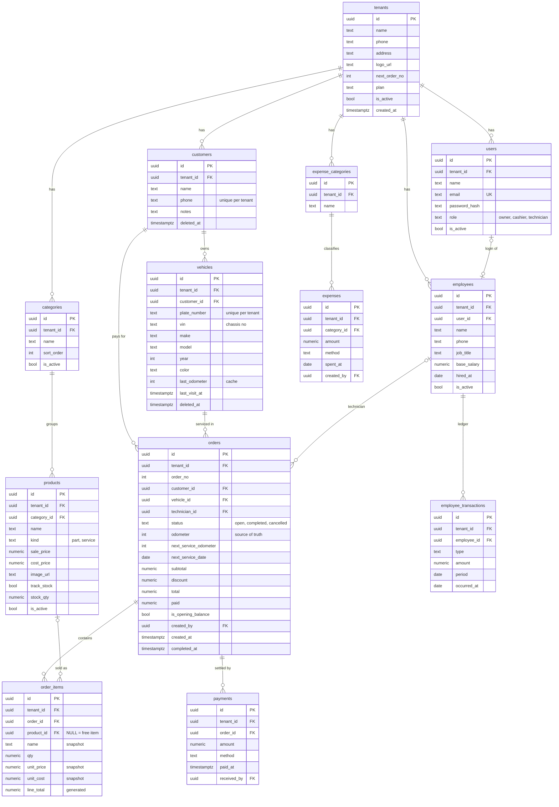
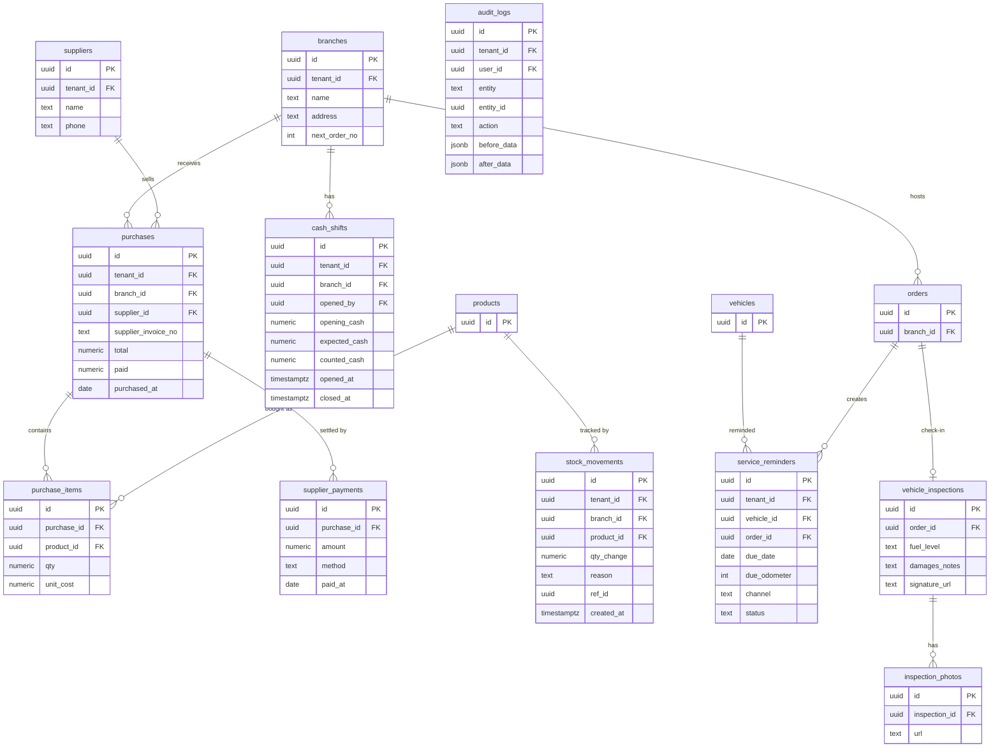

# تصميم قاعدة البيانات – SaaS لمراكز صيانة السيارات (MVP)

> **ملحوظة:** الملف ده هو اللي الـ `brief.md` بيسميه `DATABASE_DESIGN.md`.

## 0. تعديلات معتمدة (أكتوبر 2026)

القسم ده **بيتغلب على أي حاجة تخالفه في باقي الملف**. والـ SQL اللي تحت مكتوب بصيغة PostgreSQL للتوضيح بس، لكن التنفيذ الفعلي بيتعمل بـ Laravel migrations على MySQL.

| الموضوع | التعديل |
|---|---|
| الداتابيز | **MySQL 8** بدل PostgreSQL، فمفيش RLS. العزل بقى بـ Global Scope في Eloquent + Composite FKs `(tenant_id, id)` + tests عزل إجبارية |
| الـ IDs | `bigint` auto-increment بدل uuid |
| الـ Super Admin | جدول `admins` منفصل. هو اللي بينشئ المراكز والفروع، ومفيش self-signup |
| الفروع | جدول `branches` موجود من الأول (`next_order_no` و `next_receipt_no` عليه). الأوردرات والمدفوعات والإيصالات والمصروفات والموظفين والمخزون كلهم عليهم `branch_id`، والترقيم بقى **لكل فرع** |
| `tenants` | اتشال منه `next_order_no`، واتضاف `subscription_ends_at` و `cashier_max_discount` (مبلغ) و `timezone` (default `Africa/Cairo`) و `logo_path` |
| `users` | اتضاف `branch_id` nullable (null يعني الـ owner وده بيشوف كل الفروع) |
| العربيات | اتضاف `plate_normalized` (للبحث والـ unique)، و `car_make_id` / `car_model_id` (nullable) بدل make/model كنص، وده بيشاور على جداول عامة `car_makes` / `car_models` اللي الأدمن بس يضيف فيها |
| المخزون | `products.stock_qty` اتنقل لجدول `product_branch_stock (branch_id, product_id, qty)`. بيتخصم عند قفل الأوردر ويرجع عند الإلغاء، ومن غير ما يمنع البيع لو الرصيد مش كفاية |
| التحصيل | جدول **`payment_receipts`** جديد. كل عملية تحصيل = إيصال واحد برقم متسلسل للفرع، وصفوف `payments` بتشاور عليه بـ `receipt_id` |
| المرتجعات | `payments.type` بقى `payment` أو `refund`. وإلغاء أوردر مدفوع بيعمل صفوف refund، و `orders.paid = SUM(payment) − SUM(refund)` |
| التصحيح | الحركات المالية (إيصالات، مدفوعات، مصروفات، حركات الموظف) **مابتتعدلش ولا بتتمسح**، بتتعمل لها void بسبب (`voided_at`, `voided_by`, `void_reason`) |
| العربون | الدفع على أوردر `open` مسموح، والمديونية بتتحسب من الأوردرات `completed` بس |
| الفاتورة المقفولة | الـ owner بيعدلها مباشرة، والـ totals والمخزون بيتظبطوا، وكل ده بيتسجل في `audit_logs` |
| حركات الموظف | كلها كاش (مفيش عمود method). والمرتب مايتكررش لنفس الموظف في نفس الشهر، إلا لو المرتب الأول اتعمله void |
| Audit | جدول `audit_logs` (tenant_id, user_id, auditable, event, old/new values, reason, ip) |
| الوقت | التخزين UTC، والتقارير بتحسب حدود اليوم بتوقيت المركز |
| خارج الـ MVP | VAT. وفكرة إن الـ branches تتأجل لـ "المرحلة التانية" اتلغت، لأنها اتنفذت من الأول |

## 1. نظرة عامة

نظام SaaS لإدارة مراكز صيانة السيارات، بمعمارية **Multi-tenant / Single Database** على PostgreSQL.

### نطاق الـ MVP
- المراكز (Tenants) والمستخدمين والصلاحيات
- العملاء والعربيات (العميل الواحد ممكن يكون ليه أكتر من عربية)
- الأوردرات / الفواتير مع خصم على إجمالي الفاتورة
- Mini POS: تصنيفات، منتجات وخدمات، و"صنف حر"
- مديونية العملاء **موزعة على مستوى كل عربية**
- المدفوعات بطرق مختلفة (كاش، InstaPay، محافظ، كارت)
- الموظفين والرواتب والسلف والحوافز والخصومات
- المصروفات العامة (إيجار، كهرباء، مياه، مرافق...)

---

## 2. القرارات المعمارية الأساسية

### 2.1 رقم العداد: على الأوردر وعلى العربية بدورين مختلفين
- **`orders.odometer` هو مصدر الحقيقة.** كل زيارة بتسجل قراءة العداد وقتها، فبيتبني تاريخ كامل للعربية من غير جدول إضافي.
- **`vehicles.last_odometer` مجرد cache** لعرض آخر قراءة بسرعة، وبيتحدث مع كل أوردر جديد.
- **Validation:** لو القراءة الجديدة أقل من آخر قراءة يطلع **تحذير ومن غير منع**، لأن العداد ممكن يكون اتغير أو عطلان.
- **`next_service_odometer` و `next_service_date`** على الأوردر بيحددوا موعد الصيانة الجاية، وبيتبنى عليهم نظام التذكير.

### 2.2 الأوردر هو الفاتورة
مفيش جدول فواتير منفصل في الـ MVP. الأوردر بيبدأ `open`، ولما يخلص يتحول `completed` ويبقى هو الفاتورة. أي مرحلة إضافية بعدين (زي عروض الأسعار) هتبقى status جديدة ومش جدول جديد.

### 2.3 المديونية بتتحسب ومش بتتخزن
- مفيش column اسمه `debt` على العميل.
- كل أوردر عليه `total` و `paid`.
- **مديونية العربية** = مجموع (`total - paid`) لأوردراتها المقفولة.
- **مديونية العميل** = مجموع مديونيات عربياته.
- الدفع **مربوط بالأوردر** ومش بالعميل، عشان نقدر نفصل دين كل عربية.

> **مثال:** عميل عنده 3 عربيات وعليه 700ج. العربية الأولى عليها 300، والتانية 400، والتالتة مدفوعة بالكامل. ده بيطلع أوتوماتيك من الـ view اسمه `vehicle_balances`.

**الدفعة المجمّعة:** لو العميل دفع مبلغ واحد، الـ backend بيوزعه على الأوردرات المفتوحة من الأقدم للأحدث، ويعمل `payment` row لكل أوردر.

### 2.4 عزل الـ Tenants
- `tenant_id` موجود في كل جدول.
- **Composite Foreign Keys** من نوع `(tenant_id, id)`، فيبقى مستحيل على مستوى الداتابيز إن أوردر في مركز يشاور على عميل في مركز تاني.
- **Row Level Security (RLS)** كطبقة حماية تانية.

### 2.5 الـ Snapshot في بنود الفاتورة
الاسم والسعر والتكلفة بيتنسخوا في `order_items` وقت البيع. لو سعر منتج اتغير بعدين، الفواتير القديمة متتأثرش. **الصنف الحر** هو `product_id = NULL` مع اسم وسعر بيتكتبوا يدوي.

### 2.6 حساب الموظف بنظام Ledger
جدول حركات واحد لكل حاجة تخص الموظف:

| النوع | التأثير على رصيد الموظف |
|---|---|
| `salary` | + (مستحق للموظف) |
| `bonus` | + |
| `deduction` | − |
| `advance` (سلفة) | − |
| `payment` (قبض) | − |

- رصيد موجب يعني المركز عليه فلوس للموظف.
- رصيد سالب يعني الموظف عليه سلف.
- السلفة بتتخصم من المرتب أوتوماتيك من غير أي logic إضافي.

### 2.7 تغيير مالك العربية
`vehicles.customer_id` هو المالك الحالي، و `orders.customer_id` هو اللي دفع وقت الزيارة. لو العربية اتباعت، بيتغير `customer_id` على العربية بس، والتاريخ والديون القديمة بتفضل على المالك القديم.

---

## 3. ERD – الـ MVP



> ملحوظة: كل الجداول فيها `tenant_id` حتى لو الخط مش مرسوم لـ `tenants`، والخطوط اترسمت للجداول الجذرية بس عشان الرسمة تفضل واضحة.

---

## 4. الـ Schema (PostgreSQL)

```sql
-- ================= Tenancy & Users =================
CREATE TABLE tenants (
  id               uuid PRIMARY KEY DEFAULT gen_random_uuid(),
  name             text NOT NULL,
  phone            text,
  address          text,
  logo_url         text,
  next_order_no    int  NOT NULL DEFAULT 1,
  plan             text NOT NULL DEFAULT 'trial',
  is_active        boolean NOT NULL DEFAULT true,
  created_at       timestamptz NOT NULL DEFAULT now()
);

CREATE TABLE users (
  id             uuid PRIMARY KEY DEFAULT gen_random_uuid(),
  tenant_id      uuid NOT NULL REFERENCES tenants(id),
  name           text NOT NULL,
  email          text NOT NULL UNIQUE,
  password_hash  text NOT NULL,
  role           text NOT NULL CHECK (role IN ('owner','cashier','technician')),
  is_active      boolean NOT NULL DEFAULT true,
  created_at     timestamptz NOT NULL DEFAULT now(),
  UNIQUE (tenant_id, id)
);

-- ================= Customers & Vehicles =================
CREATE TABLE customers (
  id          uuid PRIMARY KEY DEFAULT gen_random_uuid(),
  tenant_id   uuid NOT NULL REFERENCES tenants(id),
  name        text NOT NULL,
  phone       text,
  notes       text,
  created_at  timestamptz NOT NULL DEFAULT now(),
  deleted_at  timestamptz,
  UNIQUE (tenant_id, id),
  UNIQUE (tenant_id, phone)
);

CREATE TABLE vehicles (
  id             uuid PRIMARY KEY DEFAULT gen_random_uuid(),
  tenant_id      uuid NOT NULL,
  customer_id    uuid NOT NULL,
  plate_number   text NOT NULL,
  vin            text,
  make           text,
  model          text,
  year           smallint,
  color          text,
  last_odometer  int,
  last_visit_at  timestamptz,
  notes          text,
  created_at     timestamptz NOT NULL DEFAULT now(),
  deleted_at     timestamptz,
  UNIQUE (tenant_id, id),
  UNIQUE (tenant_id, plate_number),
  UNIQUE (tenant_id, vin),
  FOREIGN KEY (tenant_id, customer_id) REFERENCES customers(tenant_id, id)
);

-- ================= Catalog (Mini POS) =================
CREATE TABLE categories (
  id          uuid PRIMARY KEY DEFAULT gen_random_uuid(),
  tenant_id   uuid NOT NULL REFERENCES tenants(id),
  name        text NOT NULL,
  sort_order  int  NOT NULL DEFAULT 0,
  is_active   boolean NOT NULL DEFAULT true,
  UNIQUE (tenant_id, id),
  UNIQUE (tenant_id, name)
);

CREATE TABLE products (
  id           uuid PRIMARY KEY DEFAULT gen_random_uuid(),
  tenant_id    uuid NOT NULL,
  category_id  uuid,
  name         text NOT NULL,
  kind         text NOT NULL DEFAULT 'part' CHECK (kind IN ('part','service')),
  sale_price   numeric(12,2) NOT NULL DEFAULT 0,
  cost_price   numeric(12,2),
  image_url    text,
  track_stock  boolean NOT NULL DEFAULT false,
  stock_qty    numeric(12,2) NOT NULL DEFAULT 0,
  is_active    boolean NOT NULL DEFAULT true,
  created_at   timestamptz NOT NULL DEFAULT now(),
  UNIQUE (tenant_id, id),
  FOREIGN KEY (tenant_id, category_id) REFERENCES categories(tenant_id, id)
);

-- ================= Employees =================
CREATE TABLE employees (
  id           uuid PRIMARY KEY DEFAULT gen_random_uuid(),
  tenant_id    uuid NOT NULL REFERENCES tenants(id),
  user_id      uuid,
  name         text NOT NULL,
  phone        text,
  job_title    text,
  base_salary  numeric(12,2) NOT NULL DEFAULT 0,
  hired_at     date,
  is_active    boolean NOT NULL DEFAULT true,
  UNIQUE (tenant_id, id)
);

-- ================= Orders (= Invoices) =================
CREATE TABLE orders (
  id                     uuid PRIMARY KEY DEFAULT gen_random_uuid(),
  tenant_id              uuid NOT NULL,
  order_no               int  NOT NULL,
  customer_id            uuid NOT NULL,
  vehicle_id             uuid NOT NULL,
  technician_id          uuid,
  status                 text NOT NULL DEFAULT 'open'
                         CHECK (status IN ('open','completed','cancelled')),
  odometer               int,
  next_service_odometer  int,
  next_service_date      date,
  subtotal               numeric(12,2) NOT NULL DEFAULT 0,
  discount               numeric(12,2) NOT NULL DEFAULT 0,
  total                  numeric(12,2) NOT NULL DEFAULT 0,
  paid                   numeric(12,2) NOT NULL DEFAULT 0,
  is_opening_balance     boolean NOT NULL DEFAULT false,
  notes                  text,
  created_by             uuid,
  created_at             timestamptz NOT NULL DEFAULT now(),
  completed_at           timestamptz,
  UNIQUE (tenant_id, id),
  UNIQUE (tenant_id, order_no),
  CHECK (discount >= 0 AND discount <= subtotal),
  CHECK (paid >= 0),
  FOREIGN KEY (tenant_id, customer_id)   REFERENCES customers(tenant_id, id),
  FOREIGN KEY (tenant_id, vehicle_id)    REFERENCES vehicles(tenant_id, id),
  FOREIGN KEY (tenant_id, technician_id) REFERENCES employees(tenant_id, id)
);

CREATE TABLE order_items (
  id          uuid PRIMARY KEY DEFAULT gen_random_uuid(),
  tenant_id   uuid NOT NULL,
  order_id    uuid NOT NULL,
  product_id  uuid,
  name        text NOT NULL,
  qty         numeric(10,2) NOT NULL CHECK (qty > 0),
  unit_price  numeric(12,2) NOT NULL,
  unit_cost   numeric(12,2),
  line_total  numeric(12,2) GENERATED ALWAYS AS (qty * unit_price) STORED,
  FOREIGN KEY (tenant_id, order_id)   REFERENCES orders(tenant_id, id) ON DELETE CASCADE,
  FOREIGN KEY (tenant_id, product_id) REFERENCES products(tenant_id, id)
);

CREATE TABLE payments (
  id           uuid PRIMARY KEY DEFAULT gen_random_uuid(),
  tenant_id    uuid NOT NULL,
  order_id     uuid NOT NULL,
  amount       numeric(12,2) NOT NULL CHECK (amount > 0),
  method       text NOT NULL DEFAULT 'cash'
               CHECK (method IN ('cash','instapay','wallet','card','bank')),
  paid_at      timestamptz NOT NULL DEFAULT now(),
  received_by  uuid,
  notes        text,
  FOREIGN KEY (tenant_id, order_id) REFERENCES orders(tenant_id, id)
);

-- ================= Payroll Ledger =================
CREATE TABLE employee_transactions (
  id           uuid PRIMARY KEY DEFAULT gen_random_uuid(),
  tenant_id    uuid NOT NULL,
  employee_id  uuid NOT NULL,
  type         text NOT NULL CHECK (type IN
               ('salary','bonus','deduction','advance','payment')),
  amount       numeric(12,2) NOT NULL CHECK (amount > 0),
  period       date,
  occurred_at  date NOT NULL DEFAULT current_date,
  notes        text,
  created_by   uuid,
  FOREIGN KEY (tenant_id, employee_id) REFERENCES employees(tenant_id, id)
);

-- ================= Expenses =================
CREATE TABLE expense_categories (
  id         uuid PRIMARY KEY DEFAULT gen_random_uuid(),
  tenant_id  uuid NOT NULL REFERENCES tenants(id),
  name       text NOT NULL,
  UNIQUE (tenant_id, id),
  UNIQUE (tenant_id, name)
);

CREATE TABLE expenses (
  id           uuid PRIMARY KEY DEFAULT gen_random_uuid(),
  tenant_id    uuid NOT NULL,
  category_id  uuid NOT NULL,
  amount       numeric(12,2) NOT NULL CHECK (amount > 0),
  method       text NOT NULL DEFAULT 'cash',
  spent_at     date NOT NULL DEFAULT current_date,
  notes        text,
  created_by   uuid,
  FOREIGN KEY (tenant_id, category_id) REFERENCES expense_categories(tenant_id, id)
);

-- ================= Indexes =================
CREATE INDEX ON orders   (tenant_id, vehicle_id, created_at DESC);
CREATE INDEX ON orders   (tenant_id, customer_id);
CREATE INDEX ON orders   (tenant_id, created_at DESC);
CREATE INDEX ON payments (tenant_id, order_id);
CREATE INDEX ON expenses (tenant_id, spent_at);
CREATE INDEX ON employee_transactions (tenant_id, employee_id);
CREATE INDEX ON vehicles (tenant_id, customer_id);
```

### 4.1 Views

```sql
-- مديونية كل عربية
CREATE VIEW vehicle_balances AS
SELECT tenant_id, customer_id, vehicle_id,
       SUM(total - paid) AS balance
FROM orders
WHERE status = 'completed'
GROUP BY tenant_id, customer_id, vehicle_id
HAVING SUM(total - paid) <> 0;

-- رصيد الموظف
CREATE VIEW employee_balances AS
SELECT tenant_id, employee_id,
  SUM(CASE WHEN type IN ('salary','bonus') THEN amount ELSE -amount END) AS balance
FROM employee_transactions
GROUP BY tenant_id, employee_id;
```

### 4.2 Row Level Security

```sql
ALTER TABLE orders ENABLE ROW LEVEL SECURITY;
CREATE POLICY tenant_isolation ON orders
  USING (tenant_id = current_setting('app.tenant_id')::uuid);
-- تتكرر على كل الجداول
-- وفي بداية كل request:  SET app.tenant_id = '<tenant uuid>';
```

### 4.3 ترقيم الأوردرات لكل مركز

```sql
-- آمن مع الـ concurrency (row lock على الـ tenant)
UPDATE tenants SET next_order_no = next_order_no + 1
WHERE id = $1
RETURNING next_order_no - 1 AS order_no;
```

---

## 5. قواعد الـ Business Logic (في الـ Backend)

1. **`orders.subtotal / total / paid` قيم denormalized**، فلازم تتحدث جوه **نفس الـ transaction** مع أي تعديل في `order_items` أو `payments`. الأفضل إعادة حسابها من الجداول ومش increment.
2. **`total = subtotal - discount`**
3. **مع قفل أي أوردر:** يتحدث `vehicles.last_odometer` و `last_visit_at`.
4. **الدفعة المجمّعة:** تتوزع على الأوردرات المفتوحة للعميل (أو لعربية معينة) من الأقدم للأحدث.
5. **رقم اللوحة** يتخزن normalized، يعني من غير مسافات وبشكل حروف موحد، عشان البحث والـ unique constraint يشتغلوا صح.
6. **عند إنشاء مركز جديد (Seed):**
   - تصنيفات المنتجات: زيوت، فلاتر، كاوتش، بطاريات، عمالة / مصنعية
   - تصنيفات المصروفات: إيجار، كهرباء، مياه، مرافق، نثريات
7. **الأرصدة الافتتاحية:** الديون القديمة من الدفتر الورق تتسجل كأوردر بـ `is_opening_balance = true` لكل عربية، ومتدخلش في تقارير المبيعات.
8. **تقرير الكاش الخارج** = `expenses` + حركات `advance` و `payment` من `employee_transactions`.
9. **الفواتير المقفولة** متتعدلش من الكاشير، والـ owner بس اللي يقدر يلغي.

---

## 6. الصلاحيات (MVP)

| الصلاحية | owner | cashier | technician |
|---|:-:|:-:|:-:|
| إنشاء أوردر / إضافة أصناف | ✅ | ✅ | ✅ |
| تحصيل مدفوعات | ✅ | ✅ | ❌ |
| خصم على الفاتورة | ✅ | ✅ (بحد أقصى) | ❌ |
| إلغاء / تعديل فاتورة مقفولة | ✅ | ❌ | ❌ |
| المصروفات | ✅ | ✅ | ❌ |
| الرواتب والسلف | ✅ | ❌ | ❌ |
| تقارير الأرباح | ✅ | ❌ | ❌ |

---

## 7. المرحلة التانية (مقترحات مرتبة بالأولوية)

| # | الإضافة | الجداول | السبب |
|---|---|---|---|
| 1 | الموردين والمشتريات | `suppliers`, `purchases`, `purchase_items`, `supplier_payments` | المراكز بتشتري بالآجل، ومديونية الموردين بنفس منطق `total - paid` |
| 2 | حركات المخزون | `stock_movements` | تتبع كل حركة بيع وشراء وجرد، و `stock_qty` يفضل cache |
| 3 | تذكيرات الصيانة | `service_reminders` | من `next_service_*` + WhatsApp، وده بيرجّع العميل للمركز |
| 4 | الفروع | `branches` + `branch_id` | **يُفضّل التفكير فيه من دلوقتي** لأن إضافته لاحقاً مكلفة |
| 5 | فحص الاستلام | `vehicle_inspections`, `inspection_photos` | توثيق حالة العربية بالصور يحمي المركز |
| 6 | شيفتات الدرج | `cash_shifts` | مطابقة الكاش المتوقع مع الفعلي آخر الشيفت |
| 7 | سجل التعديلات | `audit_logs` | مين عدّل أو لغى إيه وإمتى، بالقيم قبل وبعد |

### ERD – المرحلة التانية



### لاحقاً
- عروض الأسعار (Estimates) كـ status على الأوردر
- المواعيد والحجز
- عمولات الفنيين
- الفاتورة الإلكترونية (ETA – مصلحة الضرائب المصرية)
- بوابة للعميل يشوف منها تاريخ عربيته وفواتيره